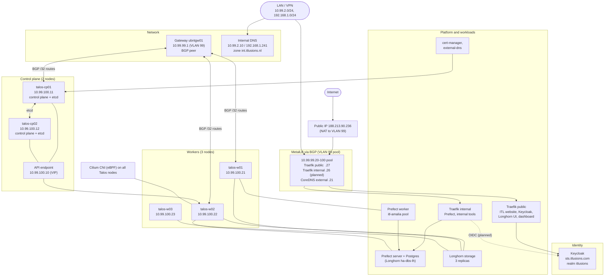

# ITL Talos cluster: proposed architecture

Main stack: **Talos** (OS), **Cilium** (CNI), **MetalLB with BGP** (load balancing), **Traefik** (ingress), **cert-manager** (certificates), **external-dns** (internal DNS records), **Keycloak** at `sts.itlusions.com` (identity), and the **ITL website**.

Five servers, two control-plane nodes. Roles are a proposal and need confirmation.

## Node roles (proposed)

| Server | Address | Role | Notes |
|---|---|---|---|
| talos-cp01 | 10.99.100.11 | Control plane | etcd, API |
| talos-cp02 | 10.99.100.12 | Control plane | etcd, API |
| talos-w01 | 10.99.100.21 | Worker | |
| talos-w02 | 10.99.100.22 | Worker | |
| talos-w03 | 10.99.100.23 | Worker | |

## Network

| Network | Purpose |
|---|---|
| 10.99.100.0/24 | Node addresses |
| 10.99.99.0/24 | VLAN 99: MetalLB pool 10.99.99.20–100, gateway 10.99.99.1 |
| 10.99.2.0/24, 10.99.1.0/24 | LAN and admin workstations, allowed by the ACL |
| 192.168.1.0/24 | Home network: Pi-hole, router, DNS |
| 188.213.90.236 | Public NAT to the Traefik public IP |

## Open points
- CNI: Cilium is the target. Current flannel removal needs a planned migration.
- Control-plane endpoint: a VIP such as `10.99.100.10`, or a DNS name, has to be chosen.
- BGP: the router's ASN and peer addresses on the node subnet are still needed.
- etcd: with two control-plane nodes, losing one breaks quorum. A third control plane is the safer layout.
- Talos image: Longhorn needs the `iscsi-tools` and `util-linux-tools` extensions.

## Component versions

Versions in use today on the Ubuntu cluster, and the versions the rebuild targets.

| Component | Today | Rebuild target | Source |
|---|---|---|---|
| Kubernetes | 1.31.14 | 1.37.1 (shipped with Talos v1.14.4) | `deploy.env.example`, Talos release notes |
| Talos Linux | not installed | v1.14.4, factory schematic `8479232c…` | `deploy.env.example` |
| Cilium | not installed (flannel today) | 1.17.6 | `deploy.env.example` |
| MetalLB | 0.14.5 (operator) | 0.14.9 | MetalLB analysis, `deploy.env.example` |
| Traefik (public and internal) | 3.1.4 (chart 31.1.1) | 3.1.4 (chart 31.1.1) for the internal instance | live deployment, `ITL.Traefik` chart |
| cert-manager | ACME solver image 1.16.0 | to confirm at install | live cluster |
| external-dns | RFC2136, version not recorded | latest chart, to confirm | live cluster |
| Keycloak | 26.2.4 | 26.2.4, restore from database dump | admin API |
| PostgreSQL (Keycloak) | 15 | 15, or a supported newer major with a migration plan | image tag |
| Prefect server and worker | 3.8.8 | 3.8.8 | Prefect charts |

