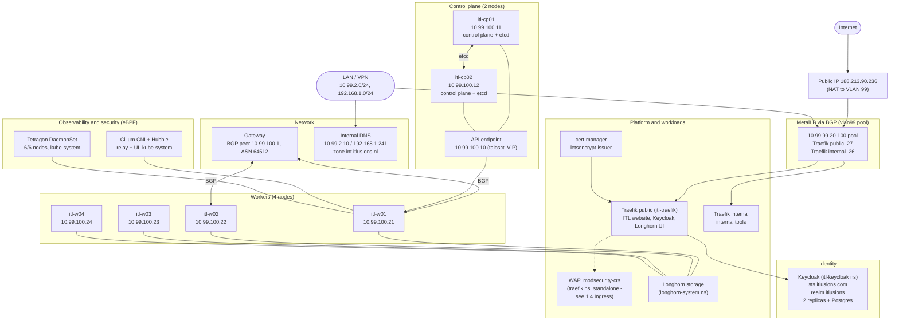

# ITL Talos cluster: current architecture

> **Rebuild complete.** The cluster described here is live, not a proposal. The pre-rebuild Ubuntu cluster is documented for reference in [0.1 Cluster capabilities (Ubuntu)](../0-historical/0.1-cluster-capabilities-ubuntu.md).

Main stack: **Talos** (OS), **Cilium** (CNI, with **Hubble** observability), **Tetragon** (eBPF runtime security), **MetalLB with BGP** (load balancing), **Traefik** (ingress, with an OWASP ModSecurity CRS **WAF**), **cert-manager** (certificates), **Longhorn** (storage), **Keycloak** via the Keycloak Operator at `sts.itlusions.com` (identity), and the **ITL website**.

Six servers: two control-plane nodes, four workers.

## Node roles

| Server | Address | Role |
|---|---|---|
| itl-cp01 | 10.99.100.11 | Control plane, etcd |
| itl-cp02 | 10.99.100.12 | Control plane, etcd |
| itl-w01 | 10.99.100.21 | Worker |
| itl-w02 | 10.99.100.22 | Worker |
| itl-w03 | 10.99.100.23 | Worker |
| itl-w04 | 10.99.100.24 | Worker |
| — | 10.99.100.10 | Control-plane VIP (`CLUSTER_VIP`, talosctl-managed) |

Confirmed live via `kubectl get nodes -o wide`: all six `Ready`, `v1.37.1`, `Talos (v1.14.4)`.

## Network

| Network | Purpose |
|---|---|
| 10.99.100.0/24 | Node addresses + control-plane VIP |
| 10.99.99.0/24 | MetalLB pool `vlan99`: 10.99.99.20–100 |
| 10.99.2.0/24, 10.99.1.0/24 | LAN and admin workstations, allowed by the ACL |
| 192.168.1.0/24 | Home network: Pi-hole, router, DNS |
| 188.213.90.236 | Public NAT to the Traefik public IP (10.99.99.27) |

The BGP peer is `bgppeer.metallb.io/vlan99-gateway` at `10.99.100.1`, ASN `64512` - on the node subnet, not the VLAN 99 pool subnet.

## Not yet deployed

These were considered for the rebuild but aren't on the live cluster: **external-dns** (no pods found cluster-wide), **ArgoCD**, **Prefect**. `cert-manager` and its `letsencrypt-issuer` ClusterIssuer are deployed and `Ready`.

## Component versions

Confirmed against the live cluster (`kubectl`) and each component's own wrapper chart repo.

| Component | Version | Source |
|---|---|---|
| Kubernetes | v1.37.1 | `kubectl version` |
| Talos Linux | v1.14.4, factory schematic `8479232c…` (iscsi-tools, util-linux-tools, intel-ucode, amd-ucode, amdgpu) | `deploy.env.example`, live nodes |
| Cilium | 1.17.6, Hubble relay + UI enabled | [`ITL.Cilium`](https://github.com/ITlusions/ITL.Cilium), live `cilium`/`cilium-operator` images |
| Tetragon | 1.7.1, 6/6 DaemonSet pods Running | [`ITL.Tetragon`](https://github.com/ITlusions/ITL.Tetragon) |
| MetalLB | live in `metallb-system` (controller + frr-k8s + speaker) | live cluster |
| Traefik (public and internal) | chart 31.1.1, plus an OWASP ModSecurity CRS WAF (standalone, not attached to any route - see [1.4 Ingress](1.4-ingress.md)) | [`ITL.Traefik`](https://github.com/ITlusions/ITL.Traefik) |
| cert-manager | `letsencrypt-issuer` ClusterIssuer Ready | live cluster |
| Longhorn | 1.13.0, 8 storage classes, UI IP-allowlisted | [`ITL.Longhorn`](https://github.com/ITlusions/ITL.Longhorn), live `longhorn-system` |
| Keycloak | 26.8.1, via Keycloak Operator, `itl-keycloak` namespace, 2 replicas + Postgres | [`ITL.Keycloak.Tenants`](https://github.com/ITlusions/ITL.Keycloak.Tenants), live cluster |

