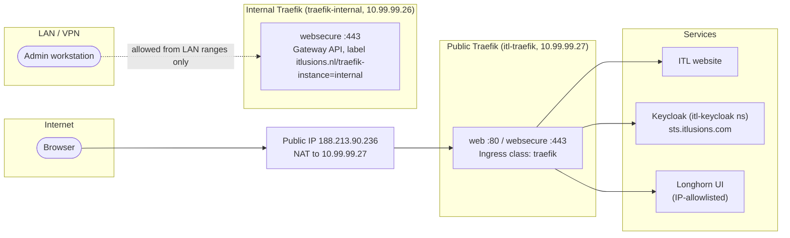

# 1.4 Ingress

Two Traefik instances handle ingress. The public one takes traffic from the internet, and the internal one takes traffic from the LAN and VPN only. They never share a listener.

## Traffic paths

## Public instance

| Item | Value |
|---|---|
| Ingress class | `itl-traefik` (and `traefik`, same instance) |
| LoadBalancer | `10.99.99.27` (from the VLAN 99 pool) |
| Public address | `188.213.90.236`, NAT to the LoadBalancer |
| Entry points | `web` (80, redirects to HTTPS), `websecure` (443) |
| Certificates | cert-manager, `letsencrypt-issuer`, HTTP-01 |
| Hosts | ITL website, `sts.itlusions.com`, and any other name that's meant to be public |

The HTTP-01 challenge needs port 80 reachable from the internet on the public address. A new public name only works once its DNS record points at `188.213.90.236`.

## WAF (OWASP ModSecurity CRS)

The public Traefik instance's chart (`ITL.Traefik`) also deploys a standalone `modsecurity-crs` WAF, fronted by the [traefik-modsecurity-plugin](https://github.com/acouvreur/traefik-modsecurity-plugin). It's running in the `traefik` namespace but **not currently attached to any Ingress**: its Go HTTP client follows redirects by default, so attaching it to a route with a redirect-based auth flow (login/logout/OIDC) causes the plugin to chase the redirect itself with a mangled `Host` header, breaking the flow entirely. It was briefly attached to the ITL website's Ingress and reverted after this broke Keycloak login/logout. See `ITL.Traefik`'s README for the full explanation before re-attaching it to any route.

## Internal instance

| Item | Value |
|---|---|
| Entry point | `websecure` on 8443, exposed as 443 |
| Routing | Gateway API. Only Gateways with the label `itlusions.nl/traefik-instance=internal` are handled |
| GatewayClass / Gateway | `traefik-internal` / `internal` in `traefik-internal` |
| LoadBalancer | `10.99.99.26` (live), with `loadBalancerSourceRanges` limited to the LAN and VPN |
| Certificates | Secret `internal-tls`, from cert-manager with DNS-01 (TransIP webhook) for `*.k8s.int.itlusions.nl` |
| Dashboard and API | Off. `api.insecure` is `false` |

The internal instance has no public address, so nothing from the internet reaches it. Route ACLs are on the source ranges in the Service and the `acl` middleware.

## Names and DNS

| Name type | Example | Resolves to | Owner |
|---|---|---|---|
| Public | `sts.itlusions.com` | `188.213.90.236` | public DNS (TransIP) |
| Internal | `prefect.k8s.int.itlusions.nl` | `10.99.99.26` | internal DNS, zone `int.itlusions.nl` (see [1.6 DNS](1.6-dns.md)) |

`external-dns` writes into the internal zone `int.itlusions.nl` through RFC2136 (see [1.6 DNS](1.6-dns.md)). It doesn't manage public names. The `apps.public.k8s.int.itlusions.com` records in the old setup were created by hand in public DNS, and they're stale.

## Request flow

1. A client resolves the name (public or internal DNS).
2. The request reaches the instance's LoadBalancer IP. The public instance gets it through the NAT, and the internal instance is reached directly on VLAN 99.
3. Traefik matches the host and path to an Ingress (public) or an HTTPRoute (internal).
4. Traefik terminates TLS with the Secret named for that host, and forwards the request to the Service.
5. The Service sends it to a ready pod.

If no certificate matches a host, Traefik serves its default self-signed certificate.
