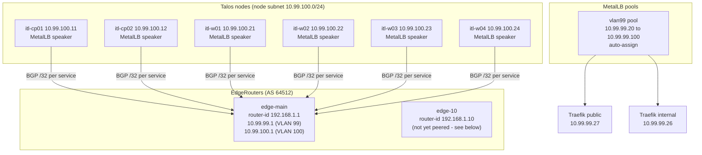

# 1.5 Load balancing and BGP

MetalLB runs in BGP mode, so each LoadBalancer IP is advertised to the routers as a /32 route. Cilium is the CNI and doesn't handle LoadBalancer IPs. MetalLB is the only LoadBalancer controller.

## Components



## Current BGP design (confirmed live)

> **Status: deployed and confirmed live** via `kubectl -n metallb-system get ipaddresspools,bgppeers,bgpadvertisements` against the running Talos cluster. The sections below that described this as a future plan are now out of date and have been folded into this one.

| Item | Value |
|---|---|
| Mode | BGP (`BGPAdvertisement` for pool `vlan99`) |
| Peer resource | `bgppeer.metallb.io/vlan99-gateway` |
| Peer address | `10.99.100.1` (node subnet, `edge-main`'s VLAN 100 address - not its VLAN 99 address) |
| ASN, both sides | `64512` |
| Advertised pool | `vlan99`, `10.99.99.20` to `10.99.99.100` |
| MetalLB version | `0.16.1`+ required with Kubernetes 1.37+ - see `deploy.env.example` for why (0.14.x's BGPPeer CRD schema is rejected by 1.37's structural validation) |
| Per service | one /32 route for each LoadBalancer IP |

Only **one** BGP peer (`edge-main` at `10.99.100.1`) is currently configured. `edge-10` is not yet peered - its VLAN 100 address still needs to be set and added as a second `BGPPeer` resource for router-level redundancy. Until then, `edge-main` going down takes BGP-advertised routes with it (see Failure cases below).

## How a LoadBalancer IP is announced

1. A Service of type `LoadBalancer` is created, for example Traefik internal.
2. MetalLB assigns an IP from the `vlan99` pool, such as `10.99.99.26`.
3. The speaker on each node with a healthy endpoint announces `10.99.99.26/32` over its BGP session to the routers.
4. The routers install the /32 route. Traffic from the LAN, which reaches the routers on VLAN 99, goes to a node that announced the route.
5. The node forwards the traffic to the Traefik pod.

If a node drops its session, its routes are withdrawn, and the other nodes keep serving the IP.

## Failure cases

| Failure | Effect |
|---|---|
| One speaker or node goes down | Its routes are withdrawn. Other nodes keep the IP reachable, as long as one healthy endpoint is left |
| Both routers are down | Routes stay installed until the BGP hold timer expires, then the IPs become unreachable from the LAN |
| The VLAN 99 pool runs out | New LoadBalancer Services stay `<pending>`. Current IPs keep working |
| Session flapping | Routes flap with it. Check the speaker logs and node health first |

## Checks

```
kubectl -n metallb-system get ipaddresspools,bgppeers,bgpadvertisements
kubectl -n metallb-system logs ds/metallb-speaker --tail=50
kubectl get svc -A | grep LoadBalancer
```

On the EdgeRouter, check the BGP session state and the received routes for the `10.99.99.x` addresses.
