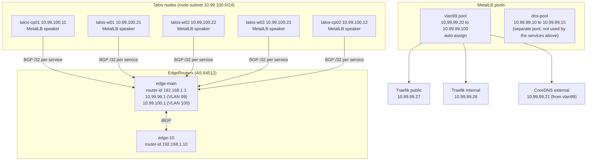

# 1.5 Load balancing and BGP

MetalLB runs in BGP mode, so each LoadBalancer IP is advertised to the routers as a /32 route. Cilium is the CNI and doesn't handle LoadBalancer IPs. MetalLB is the only LoadBalancer controller.

## Components



## Current BGP design

| Item | Value |
|---|---|
| Mode | BGP (`BGPAdvertisement` with `aggregationLength: 32`) |
| ASN, both sides | `64512` (iBGP) |
| Routers | `edge-main` (`192.168.1.1`), `edge-10` (`192.168.1.10`), both configured with `maximum-paths ibgp 32` |
| Advertised pool | `vlan99`, `10.99.99.20` to `10.99.99.100` |
| Per service | one /32 route for each LoadBalancer IP |

The router backups show neighbours `10.99.100.2` to `10.99.100.6`, which are the Ubuntu nodes. Those are replaced during the rebuild.

## Planned design for the Talos cluster

| Item | Value |
|---|---|
| Node subnet | `10.99.100.0/24`, widened from `/29`. Gateway `10.99.100.1` |
| Node ASN | `64512` (`BGP_NODE_ASN`) |
| Peers | `10.99.100.1` (`edge-main`), plus `edge-10` once its VLAN 100 address is set |
| Advertised pool | `vlan99` (unchanged) |

Peer addresses are the routers' VLAN 100 addresses. They aren't set in the repo yet, so this part is a plan, not configuration. `BGP_ROUTER_ADDRESS` in `deploy.env` holds one of them.

## How a LoadBalancer IP is announced

1. A Service of type `LoadBalancer` is created, for example Traefik internal.
2. MetalLB assigns an IP from the `vlan99` pool, such as `10.99.99.26`.
3. The speaker on each node with a healthy endpoint announces `10.99.99.26/32` over its BGP session to the routers.
4. The routers install the /32 route. Traffic from the LAN, which reaches the routers on VLAN 99, goes to a node that announced the route.
5. The node forwards the traffic to the Traefik pod.

If a node drops its session, its routes are withdrawn, and the other nodes keep serving the IP.

## Failure cases

| Failure | Effect |
|---|---|
| One speaker or node goes down | Its routes are withdrawn. Other nodes keep the IP reachable, as long as one healthy endpoint is left |
| Both routers are down | Routes stay installed until the BGP hold timer expires, then the IPs become unreachable from the LAN |
| The VLAN 99 pool runs out | New LoadBalancer Services stay `<pending>`. Current IPs keep working |
| Session flapping | Routes flap with it. Check the speaker logs and node health first |

## Checks

```
kubectl -n metallb-system get ipaddresspools,bgppeers,bgpadvertisements
kubectl -n metallb-system logs ds/metallb-speaker --tail=50
kubectl get svc -A | grep LoadBalancer
```

On the EdgeRouter, check the BGP session state and the received routes for the `10.99.99.x` addresses.
