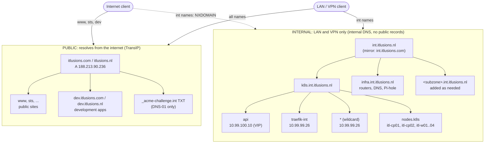

# 1.6 DNS hierarchy

> **Status: live.** Updated 2026-10-24 - `external-dns` is now deployed (see [`ITlusions/ITL.ExternalDNS`](https://github.com/ITlusions/ITL.ExternalDNS)), confirmed syncing against the real BIND server with no errors. The zone hierarchy below (`int.itlusions.nl`, `k8s.int.itlusions.nl`, `infra.int.itlusions.nl`) is live on `pandora` too - see [`ITlusions/ITL.Bind.Config`](https://github.com/ITlusions/ITL.Bind.Config) for the server side (zones, TSIG keys, the CI/CD pipeline that deploys config changes to it). `int.itlusions.com` (the zone that already existed before this work) stays alive alongside `int.itlusions.nl`, not a byte-identical mirror - it has its own distinct real content.

Two kinds of names, split by who can resolve them:

- **External names** resolve from the internet. They point at the public address `188.213.90.236`, which NATs to the public Traefik (`10.99.99.27`). These are the domains `itlusions.com`, `itlusions.nl`, and their `dev.` subzones.
- **Internal names** resolve only on the LAN and VPN. They have no public records at all, so from outside they don't exist (NXDOMAIN). These are `int.itlusions.nl` and `int.itlusions.com`, with their subzones.

## Diagram



## Hierarchy

```
PUBLIC (TransIP, authoritative for itlusions.com and itlusions.nl)
itlusions.com / itlusions.nl                 apex and public sites   A 188.213.90.236
├── www, sts (.com), ...                     public services         -> public Traefik
├── dev.itlusions.com / dev.itlusions.nl     development, public     -> public Traefik
│   └── <app>.dev...                         one host per app
└── _acme-challenge.int.itlusions.nl         TXT only, for the internal wildcard (DNS-01)

INTERNAL (internal DNS server, authoritative for int.* only, no public records)
int.itlusions.nl                             canonical internal root
├── k8s.int.itlusions.nl                     Kubernetes cluster
│   ├── api                                  A 10.99.100.10   control-plane VIP
│   ├── traefik-int                          A 10.99.99.26    internal Traefik
│   ├── *                                    A 10.99.99.26    default: internal ingress
│   └── nodes.k8s                            node A records (itl-cp01.nodes.k8s...)
├── infra.int.itlusions.nl                   routers, DNS, Pi-hole (existing hosts)
└── <subzone>.int.itlusions.nl               added per team or service as needed

int.itlusions.com                            mirror of int.itlusions.nl (same records)
```

`int.itlusions.com` is a mirror, so names work under either domain. One zone is the source of truth (`.nl`), and the `.com` zone is generated from it.

## Who resolves what

| Name | Resolves on the internet | Resolves on the LAN | Ingress |
|---|---|---|---|
| `www.itlusions.nl`, `sts.itlusions.com` | yes, `188.213.90.236` | yes | public Traefik |
| `<app>.dev.itlusions.nl` | yes, `188.213.90.236` | yes | public Traefik |
| `prefect.k8s.int.itlusions.nl` | no (NXDOMAIN) | yes, `10.99.99.26` | internal Traefik |
| `api.k8s.int.itlusions.nl` | no | yes, `10.99.100.10` | none (API) |
| `*.k8s.int.itlusions.nl` | no | yes, `10.99.99.26` | internal Traefik |

## Certificates

- **Public names** (`itlusions.com/.nl`, `dev.*`): HTTP-01 through the public Traefik, using `letsencrypt-issuer`. A wildcard for `dev` can be added with DNS-01 if needed.
- **Internal names** (`*.k8s.int.itlusions.nl`, `*.int.itlusions.nl`): one wildcard per zone, from Let's Encrypt with DNS-01. The TXT record `_acme-challenge.int.itlusions.nl` goes in the public zone, since that's where Let's Encrypt looks. The internal names themselves stay unpublished.

Caution: a TXT record in the public zone, and the wildcard certificate, are visible in public Certificate Transparency logs. They reveal that `int.itlusions.nl` and its subzones exist, though not which hosts are behind them. If that's a problem, use an internal CA for the internal names instead.

## Who writes which records

- **Public zone (TransIP):** the apex and public host records, managed by hand or through a provider integration. cert-manager writes only the `_acme-challenge` TXT records through the TransIP webhook.
- **Internal zone (internal DNS):** the `int.*` zones. **external-dns** writes the cluster records through RFC2136 (`192.168.1.241:5354`), scoped to all three zones its `externaldns-int` TSIG key is granted on: `int.itlusions.nl`, `k8s.int.itlusions.nl`, `infra.int.itlusions.nl`. It reads Services, Ingresses, and Gateway API routes, so a new Service or route gets its record automatically. Its TXT ownership records (`external-dns-*`, owner `itl-talos`) mark what it manages. Deployed via [`ITlusions/ITL.ExternalDNS`](https://github.com/ITlusions/ITL.ExternalDNS) - no longer raw values in this repo.

## Changes to make

1. **Create the internal zones** `int.itlusions.nl` and `int.itlusions.com` on the internal DNS server, with the records above.
2. **Restrict external-dns** to `k8s.int.itlusions.nl`. Its RFC2136 zone is `int.itlusions.nl`.
3. **Set up the TransIP webhook** for cert-manager. Add a DNS-01 ClusterIssuer for `int.itlusions.nl`.
4. **Retire the old zones:** `public.k8s.int.itlusions.com`, the stale `apps.public.k8s.int` records, and the public `public.k8s.int` CNAME. Also drop the `k8s.itlusions.nl` plan from earlier.
5. **Check it:** from the LAN, `dig @<internal-dns> api.k8s.int.itlusions.nl` should answer. From outside, `dig @1.1.1.1 api.k8s.int.itlusions.nl` should return nothing.

## Decisions to confirm

- **Canonical zone:** `int.itlusions.nl`, with `int.itlusions.com` as a mirror, as above. Or drop the `.com` internal zone.
- **Wildcard default:** every unknown name under `k8s.int` goes to the internal ingress. That's simple, but a typo resolves. Explicit records only would be stricter.
- **Public wildcard for `dev`:** whether `*.dev.itlusions.nl` should be a wildcard, or whether each dev app gets its own host record.
