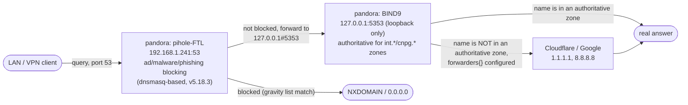
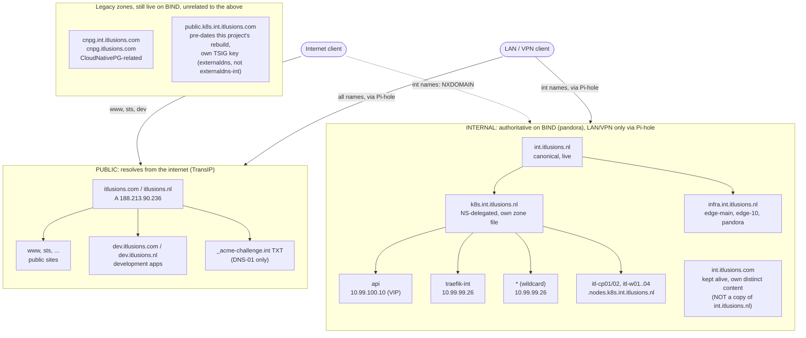

# 1.6 DNS hierarchy

> **Status: live.** Rewritten 2026-10-25 against the real, confirmed-live state - not the design. Previous versions of this doc described an intended design that didn't exist yet; everything below has been checked directly against `pandora` (`192.168.1.241`) and the cluster. See [`ITlusions/ITL.Bind.Config`](https://github.com/ITlusions/ITL.Bind.Config) (BIND server config + CI/CD) and [`ITlusions/ITL.ExternalDNS`](https://github.com/ITlusions/ITL.ExternalDNS) (the Kubernetes side) for the actual source of truth - this doc explains how they fit together.

Two kinds of names, split by who can resolve them:

- **External names** resolve from the internet. They point at the public address `188.213.90.236`, which NATs to the public Traefik (`10.99.99.27`). These are the domains `itlusions.com`, `itlusions.nl`, and their `dev.` subzones.
- **Internal names** resolve only on the LAN and VPN. They have no public records at all, so from outside they don't exist (NXDOMAIN). These are `int.itlusions.nl` and `int.itlusions.com`, with their subzones.

## The real resolution path for internal names - Pi-hole, then BIND

This is the part earlier versions of this doc never actually documented: **a LAN/VPN client's query doesn't go to BIND directly.** It goes to Pi-hole first.



**Confirmed directly on `pandora`, 2026-10-24/25:**

- Pi-hole (`pihole-FTL`, **v5.18.3** - legacy major version; `pihole -v` itself reports v6.5 is current, worth an eventual upgrade, not urgent) listens on `192.168.1.241:53`, `DNSMASQ_LISTENING=all`.
- Its generated dnsmasq config (`/etc/dnsmasq.d/01-pihole.conf`) has exactly one upstream: **`server=127.0.0.1#5353`** - BIND's own loopback-only listener (see `named.conf.options`: `listen-on port 5353 { 127.0.0.1; }`). Nothing else is configured upstream; Pi-hole's entire non-blocked query stream goes to BIND, not straight to the internet.
- Pi-hole runs **natively as a systemd service**, not in Docker, despite `pandora` also being a general-purpose Docker host for other things (per `ITL.EdgeRouterBackup`'s network notes).
- Pi-hole's own gravity database (`/etc/pihole/gravity.db`) aggregates **~8.5 million blocked domains** from 29 enabled adlists (StevenBlack's hosts, several Firebog lists, phishing/malware/ransomware/tracking feeds). This is a real, substantial blocking layer, not a token default list.
- Pi-hole holds exactly **one** local DNS override of its own (`/etc/pihole/custom.list`): `192.168.1.241 gate.itlusions.nl` - not part of the BIND-managed hierarchy below, a separate, Pi-hole-native record.
- `REV_SERVER=false`, `DNSSEC=false` - no reverse-DNS integration with the router, no DNSSEC validation at the Pi-hole layer.

**Why this matters for anything in the hierarchy below**: Pi-hole is a transparent forwarder for every name in this document - it blocks or passes through, it doesn't know about `int.itlusions.nl`'s internal structure at all. If a name isn't resolving on the LAN, check Pi-hole's query log first (is it being blocked by a gravity list match?) before assuming BIND or external-dns is broken.

## Diagram



## Hierarchy, as actually configured on BIND today

```
PUBLIC (TransIP, authoritative for itlusions.com and itlusions.nl)
itlusions.com / itlusions.nl                 apex and public sites   A 188.213.90.236
├── www, sts (.com), ...                     public services         -> public Traefik
├── dev.itlusions.com / dev.itlusions.nl     development, public     -> public Traefik
│   └── <app>.dev...                         one host per app
└── _acme-challenge.int.itlusions.nl         TXT only, for the internal wildcard (DNS-01)

INTERNAL - BIND, authoritative, the zones this project actually manages
int.itlusions.nl                             canonical internal root - LIVE
├── k8s.int.itlusions.nl                     own zone file, NS-delegated - LIVE
│   ├── api                                  A 10.99.100.10   control-plane VIP
│   ├── traefik-int                          A 10.99.99.26    internal Traefik
│   ├── *                                    A 10.99.99.26    default: internal ingress
│   └── <node>.nodes                         itl-cp01, itl-cp02, itl-w01..04
└── infra.int.itlusions.nl                   own zone, separate from int.itlusions.nl
    ├── edge-main                            A 192.168.1.1    router/gateway
    ├── edge-10                              A 192.168.1.10   downstream switch/router
    └── pandora                              A 192.168.1.241  this box itself

int.itlusions.com                            KEPT ALIVE, not dropped, NOT a mirror -
                                              has its own distinct real content: a
                                              cnpg NS delegation, and www/mail/argocd
                                              hosts that don't exist under .nl at all

LEGACY - still live on BIND, not part of this project's management
cnpg.int.itlusions.com / cnpg.itlusions.com  CloudNativePG-related, undocumented
                                              origin, not touched by this work
k8s.int.itlusions.com                        type forward -> CoreDNS (10.99.99.20),
                                              NOT the same mechanism as k8s.int.itlusions.nl
public.k8s.int.itlusions.com                 pre-dates this project's server rebuild;
                                              its own separate TSIG key ("externaldns",
                                              not "externaldns-int") still has an
                                              update-policy grant here
```

**`int.itlusions.com` is deliberately NOT a byte-identical mirror of `int.itlusions.nl`.** Earlier versions of this doc assumed it would be; once actually looked at, `.com` turned out to already have its own real, distinct records (the `cnpg` delegation, `www`/`mail`/`argocd` hosts) that a literal copy would have destroyed, and its own `k8s.int.itlusions.com` forward-to-CoreDNS setup already does a different job than `k8s.int.itlusions.nl`'s NS delegation. The decision made: keep both zones alive, independently, rather than force one to mirror the other.

## TSIG keys - two of them, don't mix up which zone each covers

| Key | Grants update rights on | Used by |
|---|---|---|
| `externaldns-int` | `int.itlusions.nl`, `k8s.int.itlusions.nl`, `infra.int.itlusions.nl` | The current, live [`ITL.ExternalDNS`](https://github.com/ITlusions/ITL.ExternalDNS) deployment |
| `externaldns` | `public.k8s.int.itlusions.com` only | An older deployment that pre-dates this project; not used by the current one, which doesn't even have this key's secret |

## Who writes which records

- **Public zone (TransIP):** the apex and public host records, managed by hand or through a provider integration. cert-manager writes only the `_acme-challenge` TXT records through the TransIP webhook.
- **Internal zones (BIND):** `int.itlusions.nl`, `k8s.int.itlusions.nl`, `infra.int.itlusions.nl` - all three writable by **external-dns**, deployed via [`ITlusions/ITL.ExternalDNS`](https://github.com/ITlusions/ITL.ExternalDNS), over RFC2136 (`192.168.1.241:5354` - note: port `5354`, not BIND's loopback `5353` used for the Pi-hole forward above; this is BIND's separate LAN-facing listener). Reads `service`/`ingress`/`gateway-httproute` sources, so a new Service or route gets its record automatically. TXT ownership records (`external-dns-*`, owner `itl-talos`) mark what it manages.
- **`int.itlusions.com`, `infra.int.itlusions.nl`'s router entries, the legacy zones:** hand-maintained, static zone files, no automation.
- **BIND config changes of any kind** go through [`ITlusions/ITL.Bind.Config`](https://github.com/ITlusions/ITL.Bind.Config)'s GitHub Actions pipeline now - edit a zone file, push to `main`, it validates (`named-checkconf`/`named-checkzone`) and deploys (via a narrowly-scoped root script on `pandora`, reached by the GitHub runner joining the existing Headscale tailnet) automatically. Manual SSH edits to `/etc/bind/` on `pandora` are no longer the normal path.

## Who resolves what

| Name | Resolves on the internet | Resolves on the LAN (via Pi-hole -> BIND) | Ingress |
|---|---|---|---|
| `www.itlusions.nl`, `sts.itlusions.com` | yes, `188.213.90.236` | yes | public Traefik |
| `<app>.dev.itlusions.nl` | yes, `188.213.90.236` | yes | public Traefik |
| `traefik-int.k8s.int.itlusions.nl` | no (NXDOMAIN) | yes, `10.99.99.26` | internal Traefik |
| `api.k8s.int.itlusions.nl` | no | yes, `10.99.100.10` | none (API) |
| `*.k8s.int.itlusions.nl` | no | yes, `10.99.99.26` | internal Traefik |
| `pandora.infra.int.itlusions.nl` | no | yes, `192.168.1.241` | none (infra host) |

## Certificates

- **Public names** (`itlusions.com/.nl`, `dev.*`): HTTP-01 through the public Traefik, using `letsencrypt-issuer`. A wildcard for `dev` can be added with DNS-01 if needed.
- **Internal names** (`*.k8s.int.itlusions.nl`, `*.int.itlusions.nl`): one wildcard per zone, from Let's Encrypt with DNS-01. The TXT record `_acme-challenge.int.itlusions.nl` goes in the public zone, since that's where Let's Encrypt looks. The internal names themselves stay unpublished.

Caution: a TXT record in the public zone, and the wildcard certificate, are visible in public Certificate Transparency logs. They reveal that `int.itlusions.nl` and its subzones exist, though not which hosts are behind them. If that's a problem, use an internal CA for the internal names instead. Not yet built.

## Verification

```bash
# stdlib-only, no dig needed - see ITL.Bind.Config/deploy/dns_smoke_test.py
python3 dns_smoke_test.py
```

Confirmed passing 10/10 (2026-10-24/25), covering `int.itlusions.nl`, `k8s.int.itlusions.nl` (including node records and the control-plane VIP), `infra.int.itlusions.nl`, and `int.itlusions.com`. If you don't have that script, the manual equivalent from a LAN/VPN client:

```bash
dig @192.168.1.241 -p 5354 api.k8s.int.itlusions.nl +short   # direct to BIND, bypassing Pi-hole
dig @192.168.1.241 api.k8s.int.itlusions.nl +short            # through Pi-hole, port 53 - the real client path
dig @1.1.1.1 api.k8s.int.itlusions.nl +short                   # should return nothing, from outside
```

## Resolved since the last version of this doc

1. ~~Create the internal zones~~ **Done** - `int.itlusions.nl`, `k8s.int.itlusions.nl`, `infra.int.itlusions.nl` all live, via `ITL.Bind.Config`.
2. ~~Restrict external-dns to k8s.int.itlusions.nl~~ **Superseded by a deliberate later decision** - it now manages all three zones the `externaldns-int` key is granted on, not just `k8s.int.itlusions.nl`. See `ITL.ExternalDNS`'s README for why.
3. **Still open:** the TransIP webhook + DNS-01 `ClusterIssuer` for `int.itlusions.nl` - not built yet, internal wildcard certs still need their `_acme-challenge` TXT record handled some other way for now.
4. ~~Retire the old zones~~ **Decided differently than planned:** `int.itlusions.com` is kept, not retired (see above). `public.k8s.int.itlusions.com` turned out to pre-date this project's server rebuild rather than being something to actively retire - it's just inert legacy, left alone rather than touched.
5. ~~Check it~~ **Done** - see Verification above.

## Decisions to confirm, still open

- **Public wildcard for `dev`:** whether `*.dev.itlusions.nl` should be a wildcard, or whether each dev app gets its own host record. Not resolved by this round of work.
- **Internal CA for internal names**, to stop the DNS-01 TXT record (once built) from revealing `int.itlusions.nl`'s existence in public CT logs - flagged above, not decided.
- **Pi-hole's own major-version gap** (v5.18.3 live vs v6.x current) - not a DNS-correctness problem today, but worth a deliberate upgrade decision at some point rather than indefinite drift.
